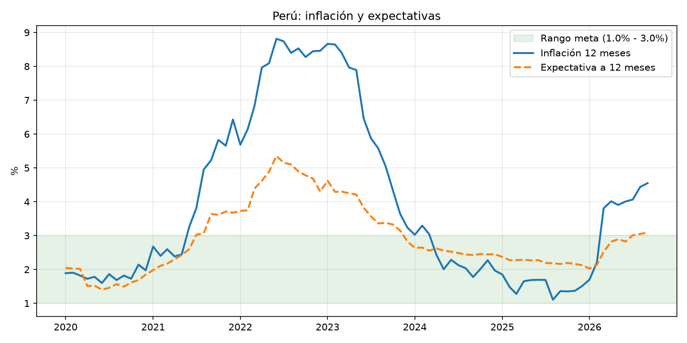
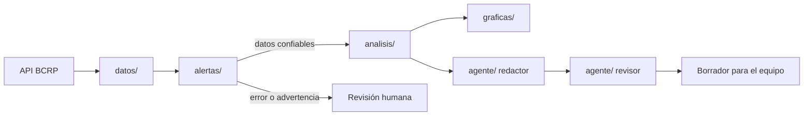

# macro-agente

Sistema agéntico que automatiza el seguimiento mensual de inflación y genera un primer borrador de análisis de coyuntura, listo para validación por parte de un analista.

**Estado:** Perú completo · Colombia en desarrollo

---

## ¿Qué hace?

Con un solo comando (`python main.py`), el sistema:

1. **Descarga** el IPC y las expectativas de inflación desde la API del BCRP.
2. **Valida** los datos: detecta series desactualizadas, vacías o con valores atípicos.
3. **Analiza** la inflación frente al rango meta y calcula el error de pronóstico.
4. **Grafica** inflación vs. expectativas con la franja del rango meta.
5. **Redacta** un párrafo de coyuntura con un agente de IA (Claude).
6. **Revisa** el borrador con un segundo agente que verifica cada cifra contra los datos.

## Ejemplo de resultado



> *"En septiembre de 2026, la inflación a 12 meses en Perú se ubicó en 4,55%, por encima del rango meta de 1,0% a 3,0% (...). Las expectativas de inflación a 12 meses se ubican en 3,09% según la Encuesta de Expectativas Macroeconómicas del BCRP, ligeramente por encima del límite superior del rango meta."*
>
> — Extracto del borrador generado y aprobado por el agente revisor ([reporte completo](salidas/reporte_peru.md))

## Arquitectura



| Módulo | Función |
|---|---|
| `datos/` | Conectores a fuentes oficiales (hoy: BCRP) |
| `alertas/` | Controles de calidad: rezago, series vacías, atípicos, meta |
| `analisis/` | Error de pronóstico y ficha resumen del último dato |
| `graficas/` | Banco de gráficas parametrizadas y reutilizables |
| `agente/` | Agentes redactor y revisor (patrón de reflexión) |
| `config.yaml` | Países, series, metas y parámetros: se escala sin tocar el código |

## Decisiones de diseño

- **Error de pronóstico con la expectativa correcta.** La encuesta del BCRP pregunta por la inflación de los próximos 12 meses, por lo que la inflación observada se compara con la expectativa formulada 12 meses antes, no con la del mismo mes.
- **Los datos dudosos bloquean al agente.** Si hay alertas de error o advertencia, el sistema no redacta: es preferible no escribir nada a escribir algo convincente con datos incorrectos. Esta regla está en el código, no en las instrucciones a la IA.
- **Reflexión con el mismo contexto.** El revisor recibe exactamente la misma información que el redactor (ficha, alertas, fuente). En pruebas, un revisor con menos información eliminaba afirmaciones que sí estaban respaldadas.
- **Validación humana como control final.** El resultado es un borrador. Las respuestas de un modelo de lenguaje varían entre ejecuciones, por lo que el criterio del analista sigue siendo indispensable.

## Cómo ejecutarlo

```bash
git clone https://github.com/Miguelrzp/macro-agente.git
cd macro-agente
python -m venv .venv
source .venv/Scripts/activate      # Windows (Git Bash)
python -m pip install -r requirements.txt
```

Crea un archivo `.env` en la carpeta principal con tu clave de la API de Claude:

```
ANTHROPIC_API_KEY=tu-clave
```

Y ejecuta:

```bash
python main.py
```

Los resultados se guardan en `salidas/`.

## Próximos pasos

- [ ] Agregar Colombia (IPC del DANE y Encuesta de Expectativas del Banco de la República)
- [ ] Extender a otras secciones del reporte (actividad, tasas, tipo de cambio)
- [ ] Verificación automática de cifras del texto contra la ficha, sin depender del modelo
- [ ] Ejecución programada mensual tras la publicación del IPC

## Autor

**José Miguel Ruiz Pinzón** · Estudiante de Economía, Universidad Nacional de Colombia · https://www.linkedin.com/in/josemiguelruiz-p04/